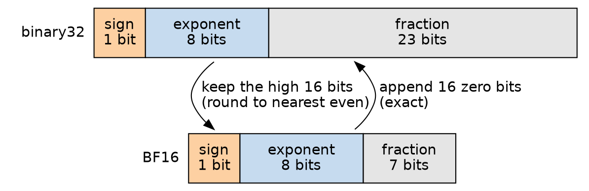
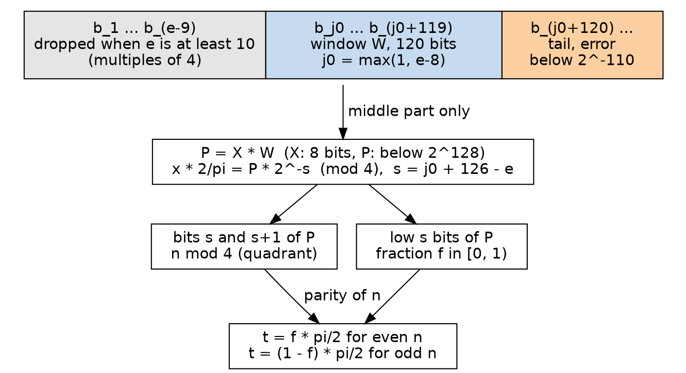
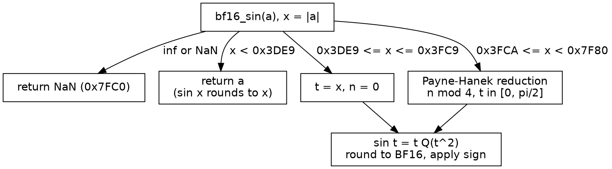
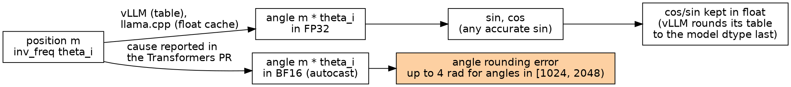

<!-- source: https://hackmd.io/@sysprog/bf16-sine -->

# Approximating the Sine Function in BF16
> contributed by Max042004 and jserv

## Motivations
In PyTorch v2.14.1, the scalar helper `sin` for reduced-precision types, BF16 included, converts to FP32, calls `std::sin`, and converts back. Staying in a 16-bit data path would remove the conversions, but BF16 has only an 8-bit significand, so any error in range reduction or in the polynomial coefficients eats directly into the 0.5 ULP budget. This note focuses on accuracy; speed and memory are compared only in order of magnitude on one x86-64 machine. It derives the BF16 error measures, the exact condition under which `sin x` can simply return `x`, the Taylor remainder, Cody-Waite and Payne-Hanek range reduction, and the error bound of Chebyshev-node interpolation. It then verifies the result exhaustively on all 65280 finite BF16 inputs on x86-64 Linux with GCC 14.2 and Clang 18.1. A Payne-Hanek reduction with a 120-bit window, followed by a polynomial built on five Chebyshev nodes and evaluated in FP32 or FP64, matches the correctly rounded `sin` bit for bit (for FP32 this is an observation, not a proof). Evaluating the polynomial with BF16 arithmetic or 16-bit fixed point still leaves some inputs 1 ULP away from the correctly rounded result on the domains tested, and error bounds on coefficient quantization and per-step rounding explain why. Finally, in the reports and examples cited here, the precision problem of rotary position embedding (RoPE) arises in the computation of the angle.

The environment is x86-64 Linux (Ubuntu 24.04, glibc 2.39) with GCC 14.2.0 and Clang 18.1.8. C programs are built with `-std=c11 -O2 -Wall -Wextra -Werror` and use the `unsigned __int128` extension that both compilers support (`redux.c` also needs `__float128` and libquadmath, so it builds with GCC only). References and coefficients come from Python 3 with mpmath 1.3.0. The numbers in this note come from the listings in it, and the exhaustive results are bit-identical between GCC and Clang.

## BF16 Format and Error Measures

### Fields and values

BF16 keeps the sign bit and the 8-bit exponent of binary32 and shrinks the fraction field to 7 bits. With the implicit leading 1, that gives an 8-bit significand. The exponent range of normal numbers therefore equals that of FP32 (the cited study lists no BF16 subnormals; the format here defines them anyway). Converting BF16 to binary32 appends 16 zero bits; the reverse conversion keeps the high 16 bits and applies a rounding rule ([Kalamkar et al.](https://arxiv.org/abs/1905.12322) cite this simplicity as the appeal of BF16 for deep learning training). BF16 is not an IEEE 754 interchange format, but the biased exponent follows IEEE 754-2019: the actual exponent plus a constant bias, chosen so that the field is never negative.

Let $s$ be the sign bit, $E$ the biased exponent field, and $M \in \{0, \dots, 127\}$ the fraction field. For $1 \le E \le 254$,

$$
v = (-1)^s \cdot 2^{E-127} \cdot \left(1 + \frac{M}{2^7}\right)
$$



For $E = 0$ the value is subnormal, $v = (-1)^s \cdot 2^{-126} \cdot M / 2^7$. For $E = 255$ it is infinity ($M = 0$) or NaN. For example, $1$ has actual exponent $0$, so $E = 127$ and the encoding is `0x3F80`; $\frac12$ has $E = 126$ and encoding `0x3F00`. The largest finite value is `0x7F7F`, $(2 - 2^{-7}) \cdot 2^{127} \approx 3.3895 \times 10^{38}$. The smallest normal value is $2^{-126} \approx 1.1755 \times 10^{-38}$, and the smallest subnormal is $2^{-133}$.

### Spacing and ULP

Each exponent has 128 BF16 values. Within $[2^e, 2^{e+1})$ neighbors are $2^{e-7}$ apart, and this spacing is the ULP (unit in the last place) of that interval. For the results of `sin`, which lie in $[-1, 1]$, the ULP halves with every power of two below 1:

| Result interval | Smallest | Largest | ULP |
|---|---|---|---|
| $[0.25, 0.5)$ | $0.25$ | $0.498046875$ | $2^{-9} = 0.001953125$ |
| $[0.5, 1)$ | $0.5$ | $0.99609375$ | $2^{-8} = 0.00390625$ |


In $[0.5, 1)$, for example, the largest value is $2^{-1} \cdot (1 + 127/128) = 0.99609375$ and the spacing is $2^{-7} \cdot 2^{-1} = 2^{-8}$. Because the ULP scales with the result, relative error is the natural measure. For a normal result, correct rounding has absolute error at most half an ULP and relative error at most

$$
\frac{2^{e-8}}{2^e (1 + M/2^7)} = \frac{2^{-8}}{1 + M/2^7} \in (2^{-9}, 2^{-8}]
$$

The upper end, $2^{-8}$, is the unit roundoff of round-to-nearest. (Subnormal results have a fixed absolute bound of $2^{-134}$ instead.) The converse does not hold: a relative error below $2^{-8}$ only guarantees an absolute error below $2^{-8} \cdot 2^{e+1} = 2^{e-7}$, which is 1 ULP, not 0.5 ULP. A correctly rounded result needs the approximation and the true value to fall in the same rounding interval.

### Reference results and the baseline

PyTorch v2.14.1 defines the scalar helper `sin` for reduced-precision types in [`c10/util/BFloat16-math.h`](https://github.com/pytorch/pytorch/blob/v2.14.1/c10/util/BFloat16-math.h#L132-L137) as `std::sin(float(a))`: compute in float, convert back. That conversion path is the baseline here; this note does not trace how `torch.sin` dispatches to it.

Evaluation is exhaustive. BF16 has 65536 bit patterns, of which 256 are infinities or NaNs, leaving 65280 finite inputs. `ref_gen.py` computes $\sin x$ for each input with 700-bit mpmath arithmetic and rounds it to BF16 with roundTiesToEven (the IEEE 754-2019 name for round to nearest, ties to even). Within either sign, BF16 encodings are monotonic in magnitude, so the absolute difference of two encodings of the same sign counts the representable-value steps between them, that is, the distance in ULPs.

```python
#!/usr/bin/env python3
"""Correctly rounded BF16 sin for every finite input, and the hardest rounding cases."""
import sys
from mpmath import mp, mpf, sin, floor

mp.prec = 700


def bf16_to_mpf(b):
    sign = -1 if b >> 15 else 1
    e, m = (b >> 7) & 0xFF, b & 0x7F
    if e == 0xFF:
        return None                         # inf, NaN
    if e == 0:
        return sign * mpf(m) * mpf(2) ** -133
    return sign * mpf(128 + m) * mpf(2) ** (e - 134)


def scale(y):
    """|y| = q * 2^(e-7) with 128 <= q < 256 (q < 128 for a subnormal)."""
    a = abs(y)
    e = int(floor(mp.log(a, 2)))
    while mpf(2) ** e > a:
        e -= 1
    while mpf(2) ** (e + 1) <= a:
        e += 1
    e = max(e, -126)
    return a / mpf(2) ** (e - 7), e


def round_nearest_even(y):
    if y == 0:
        return 0
    q, e = scale(y)
    n = int(floor(q))
    frac = q - n
    if frac > mpf(1) / 2 or (frac == mpf(1) / 2 and n & 1):
        n += 1
    if n >= 256:
        n >>= 1
        e += 1
    sign = 0x8000 if y < 0 else 0
    return sign | n if n < 128 else sign | ((e + 127) << 7) | (n - 128)


hard, same = [], []
with open(sys.argv[1], "w") as out:
    for b in range(0x10000):
        x = bf16_to_mpf(b)
        if x is None:
            continue
        y = sin(x)
        r = 0x8000 if b == 0x8000 else round_nearest_even(y)
        out.write("%04x %04x\n" % (b, r))
        if b < 0x7F80 and r == b:           # sin x rounds to x itself
            same.append(b)
        if 0x3DE9 <= b < 0x7F80:            # positive x at or above the small-argument threshold
            q, e = scale(y)
            d = abs(q - floor(q) - mpf(1) / 2)      # distance to a midpoint, in ulp
            hard.append((float(d * mpf(2) ** (e - 7) / abs(y)), b))
hard.sort()
for rel, b in hard[:3]:
    print("hardest: x=%04x relative distance to a midpoint %.4e" % (b, rel))

runs = []
for b in same:
    if runs and runs[-1][1] == b - 1:
        runs[-1][1] = b
    else:
        runs.append([b, b])
print("sin x rounds to x for x in " + ", ".join("%04x-%04x" % tuple(r) for r in runs))

t, words = 2 / mp.pi, []                    # the first 256 bits of 2/pi
for _ in range(4):
    t *= 2 ** 64
    words.append(int(floor(t)))
    t -= words[-1]
print("2/pi: " + " ".join("%016x" % w for w in words))
```

`ref_gen.py` also finds the hardest rounding case, the input where $\sin x$ is closest to a rounding boundary (the midpoint of two adjacent BF16 values), measured in relative terms.

```
hardest: x=7d29 relative distance to a midpoint 2.4436e-08
hardest: x=6881 relative distance to a midpoint 8.5349e-08
hardest: x=68c6 relative distance to a midpoint 1.6274e-07
sin x rounds to x for x in 0000-3de8, 3e01-3e12
2/pi: a2f9836e4e441529 fc2757d1f534ddc0 db6295993c439041 fe5163abdebbc561
```

The smallest relative distance is $2.4436 \times 10^{-8}$, at `0x7D29` (about $1.404 \times 10^{37}$). An approximation $\hat y$ with $|\hat y - \sin x| < 2.44 \times 10^{-8} \cdot |\sin x|$ lies on the same side of every boundary as $\sin x$, so it rounds to the same BF16. This note uses $2.44 \times 10^{-8}$ as the budget for the total relative error, covering reduction, polynomial, and floating-point rounding. The search covers $x \ge$ `0x3DE9`; smaller inputs are handled next.

The baseline itself checks out. On glibc 2.39, rounding `sinf` to nearest gives no mismatch against the reference on all 65280 inputs (see the output of `bf16sin.c` below). Truncating the binary32 result to its high 16 bits instead disagrees on 19222 inputs (29.4%). Truncation rounds toward zero, so with a truncated `sinf` as the baseline, most of the disagreement comes from the baseline, not from the implementation under test.

### Returning x for small arguments

For small $x$, $\sin x = x - x^3/6 + \cdots$ is within half an ULP of $x$, so returning $x$ is correctly rounded and skips all computation. The condition has to be derived per binade.

Let $x \in [2^e, 2^{e+1})$ and assume $x$ is not a power of two. Since $\sin x < x$, the neighbor below $x$ is $x - 2^{e-7}$, and the midpoint between them is $x - 2^{e-8}$. So $\sin x$ rounds to $x$ exactly when $x - \sin x < 2^{e-8}$. The leading term of the alternating series gives $x - \sin x \in (x^3/6 - x^5/120,\ x^3/6)$. Approximating by $x^3/6$, the condition becomes

$$
\frac{x^3}{6} < 2^{e-8} \iff 2^{2e} (1 + f)^3 < \frac{6}{2^8} = 0.0234375, \quad x = 2^e (1 + f),\ 0 \le f < 1
$$

* For $e = -5$, $2^{2e} = 2^{-10}$ and the condition is $(1+f)^3 < 24$, which always holds.
* For $e = -4$ it requires $(1+f)^3 < 6$, that is, $x < 0.1136$.
* For $e = -3$ it requires $(1+f)^3 < 1.5$, that is, $x < 0.1431$.
* If $x = 2^e$ is a power of two, the spacing below it is halved and the midpoint is $x - 2^{e-9}$, so the condition becomes $x^3/6 < 2^{e-9}$, or $2^{2e} < 6/2^9 = 0.01171875$. At $e = -3$, $2^{-6} = 0.015625$ fails, so $x = 0.125$ fails too.

The output of `ref_gen.py` lists the intervals where $\sin x$ rounds to $x$ (`sin x rounds to x for x in 0000-3de8, 3e01-3e12`), which agrees with the derivation. For positive $x$:

* `0x0000` to `0x3DE8` (subnormals included, largest value $0.11328125$) round to $x$.
* `0x3DE9` to `0x3E00` ($0.11376953125$ to $0.125$, 24 values) do not; the correctly rounded result is 1 ULP below $x$.
* `0x3E01` to `0x3E12` ($0.1259765625$ to $0.142578125$) round to $x$ again.
* From `0x3E13` ($0.1435546875$) on, none do.


The figure shows the two crossings of the first two cases (the power-of-two exception is not drawn). The threshold for returning $x$ is therefore `0x3DE9` (exclusive). A threshold of $0.140625$ (`0x3E10`) would leave the 24 inputs `0x3DE9` to `0x3E00` 1 ULP away from the correctly rounded result. The looser relative-error criterion $x^2/6 < 2^{-8}$ gives $x < 0.1531$ and only guarantees 1 ULP. Negative inputs and $\pm 0$ follow from $\sin(-x) = -\sin x$, and returning $x$ preserves the sign, including $\sin(-0) = -0$.

## Limits of the Taylor Expansion

### The remainder

The Taylor series of $\sin x$ at 0 is

$$
\sin x = \sum_{n=0}^{\infty} \frac{(-1)^n}{(2n+1)!} x^{2n+1} = x - \frac{x^3}{3!} + \frac{x^5}{5!} - \cdots
$$

For a polynomial of degree $d$, the Lagrange remainder is $R_d(x) = \frac{f^{(d+1)}(\xi)}{(d+1)!} x^{d+1}$ with $\xi$ between 0 and $x$. The derivative $f^{(d+1)}$ is $\pm\sin$ or $\pm\cos$, so its magnitude is at most 1 and

$$
|R_d(x)| \le \frac{|x|^{d+1}}{(d+1)!}
$$

For odd $d$ the coefficient of $x^{d+1}$ is zero, so the degree-$d$ and degree-$(d+1)$ polynomials coincide and the bound may also be written $|x|^{d+2}/(d+2)!$. Both bounds hold; the smaller one is the useful one.

`taylor.c` computes partial sums in double and, with the same recurrence $t_k = -t_{k-1} x^2 / (2k(2k+1))$, in BF16 with every operation rounded:

```c
/* build: gcc -std=c11 -O2 -Wall -Wextra -Werror taylor.c -lm -o taylor */
#include <math.h>
#include <stdint.h>
#include <stdio.h>
#include <string.h>

typedef uint16_t bf16_t;

static float bf16_to_f32(bf16_t a)
{
    uint32_t u = (uint32_t) a << 16;
    float f;
    memcpy(&f, &u, sizeof(f));
    return f;
}

static bf16_t f32_to_bf16(float f)
{
    uint32_t u;
    memcpy(&u, &f, sizeof(u));
    if ((u & 0x7fffffff) > 0x7f800000)
        return (u >> 16) | 0x40;
    u += 0x7fff + ((u >> 16) & 1);
    return u >> 16;
}

static float rd(float f) { return bf16_to_f32(f32_to_bf16(f)); }   /* one BF16 operation */

/* x - x^3/3! + ... up to x^(2m+1), the term recurrence t_k = -t_(k-1) x^2 / (2k (2k+1)), in double */
static double taylor_double(double x, int m)
{
    double term = x, sum = x;
    for (int k = 1; k <= m; k++) {
        term *= -x * x / ((2 * k) * (2 * k + 1));
        sum += term;
    }
    return sum;
}

/* the same recurrence, every multiplication, division and addition rounded to BF16 */
static float taylor_bf16(float x, int m, float *peak)
{
    float x2 = rd(x * x), term = x, sum = x;
    *peak = fabsf(x);
    for (int k = 1; k <= m; k++) {
        term = -rd(rd(term * x2) / rd((float) ((2 * k) * (2 * k + 1))));
        *peak = fmaxf(*peak, fabsf(term));
        sum = rd(sum + term);
    }
    return sum;
}

int main(void)
{
    const double xs[] = {2.0, 8.0};
    const int ms[] = {2, 3, 4, 6, 8, 10, 12};
    for (int i = 0; i < 2; i++) {
        double x = xs[i];
        printf("x=%g sin(x)=%.6f\n", x, sin(x));
        for (int j = 0; j < 7; j++) {
            int d = 2 * ms[j] + 1;
            double s = taylor_double(x, ms[j]);
            double loose = pow(x, d + 1) / tgamma(d + 2);   /* |x|^(d+1) / (d+1)! */
            double tight = pow(x, d + 2) / tgamma(d + 3);   /* |x|^(d+2) / (d+2)! */
            float peak, y = taylor_bf16((float) x, ms[j], &peak);
            printf("  deg %2d: sum %10.6f error %.3e bounds %.3e %.3e | BF16 sum %8.4f largest term %.0f\n", d,
                   s, fabs(s - sin(x)), loose, tight, y, peak);
        }
    }
    return 0;
}
```

```
x=2 sin(x)=0.909297
  deg  5: sum   0.933333 error 2.404e-02 bounds 8.889e-02 2.540e-02 | BF16 sum   0.9297 largest term 2
  deg  7: sum   0.907937 error 1.361e-03 bounds 6.349e-03 1.411e-03 | BF16 sum   0.9023 largest term 2
  deg  9: sum   0.909347 error 5.002e-05 bounds 2.822e-04 5.131e-05 | BF16 sum   0.9023 largest term 2
  deg 13: sum   0.909297 error 2.469e-08 bounds 1.879e-07 2.506e-08 | BF16 sum   0.9023 largest term 2
  deg 17: sum   0.909297 error 4.269e-12 bounds 4.094e-11 4.310e-12 | BF16 sum   0.9023 largest term 2
  deg 21: sum   0.909297 error 3.331e-16 bounds 3.732e-15 3.245e-16 | BF16 sum   0.9023 largest term 2
  deg 25: sum   0.909297 error 0.000e+00 bounds 1.664e-19 1.233e-20 | BF16 sum   0.9023 largest term 2
x=8 sin(x)=0.989358
  deg  5: sum 195.733333 error 1.947e+02 bounds 3.641e+02 4.161e+02 | BF16 sum 196.0000 largest term 274
  deg  7: sum -220.368254 error 2.214e+02 bounds 4.161e+02 3.699e+02 | BF16 sum -222.0000 largest term 418
  deg  9: sum 149.499824 error 1.485e+02 bounds 2.959e+02 2.152e+02 | BF16 sum 150.0000 largest term 418
  deg 13: sum  22.589378 error 2.160e+01 bounds 5.045e+01 2.691e+01 | BF16 sum  22.5000 largest term 418
  deg 17: sum   2.014152 error 1.025e+00 bounds 2.814e+00 1.185e+00 | BF16 sum   1.8438 largest term 418
  deg 21: sum   1.009962 error 2.060e-02 bounds 6.565e-02 2.283e-02 | BF16 sum   0.8359 largest term 418
  deg 25: sum   0.989564 error 2.057e-04 bounds 7.494e-04 2.220e-04 | BF16 sum   0.8164 largest term 418
```

At $x = 2$ the degree-5 polynomial has an actual error of $2.404 \times 10^{-2}$, below both $2^6/6! = 8.889 \times 10^{-2}$ and $2^7/7! = 2.540 \times 10^{-2}$, and the second bound is close. At $x = 8$ the degree-5 sum is $195.7$, an error of $194.7$; the bounds $8^6/6! = 364.1$ and $8^7/7! = 416.1$ hold but say nothing useful. For a fixed degree the bound grows with a high power of $|x|$, and so does the number of terms needed: $x = 8$ needs degree 25, among the degrees tried, to bring the error down to $2 \times 10^{-4}$.


### Cancellation in BF16 arithmetic

BF16 arithmetic makes it worse. At $x = 8$ the terms first grow and then shrink, and the largest one has power $2k + 1 \approx x$: $8^7/7! = 416.1$ (the 418 in the output is the result of step-by-step rounding), while $\sin 8 = 0.989$. The value 418 lies in $[256, 512)$, where the spacing is 2, so a single rounding can already cost up to 1, the same order as the result. At degree 25 the BF16 sum is $0.8164$, $0.173$ away from the true $0.9894$, about 44 ULP. This is catastrophic cancellation: when large terms of opposite sign are added, their high bits cancel, and what remains are the low bits that each term's rounding has already discarded.

At $x = 2$ the largest term is only 2, so cancellation is much less severe, yet the sum stalls at $0.9023$. The true $\sin 2 = 0.9093$ rounds to $0.91015625$ (`0x3F69`) in BF16, which is 2 ULP away. Two things contribute. The degree-7 BF16 sum is already $0.0056$ away from the exact degree-7 partial sum ($0.9079$) because of the earlier roundings, and after degree 7 the new terms fall below half an ULP of the sum, so nothing corrects it: $0.9023 \in [0.5, 1)$ has ULP $2^{-8}$, half of which is $0.00195$, and the degree-9 term $2^9/9! = 0.0014$ cannot be added.

Both effects lead to the same conclusion: the argument has to be reduced to a short interval first, so that a few terms suffice, and accumulation needs more precision than the output has.

## Range Reduction

### The error of direct subtraction

Since $\sin$ has period $2\pi$ and $\sin(x + \frac{\pi}{2}) = \cos x$, it suffices to know the remainder $r = x - n \cdot \frac{\pi}{2}$ and $n \bmod 4$. Let $\hat C$ be a floating-point approximation of $\pi/2$. The computed value is $\hat r = x - n \hat C + \rho$, where $\rho$ collects the rounding errors of the multiplication and subtraction, so

$$
|\hat r - r| \le |n| \cdot \left|\frac{\pi}{2} - \hat C\right| + |\rho|
$$

The first term grows linearly with $|n|$, hence with $|x|$. In float, $\hat C = 1.57079637$ differs from $\pi/2$ by $4.37 \times 10^{-8}$; in double the difference is $6.1 \times 10^{-17}$. BF16 inputs reach $3.4 \times 10^{38}$. An input is treated as an exact BF16 number (how it was obtained is the caller's business), and the reduction must produce $x \bmod \pi/2$ of that exact value. The largest inputs need about 240 bits of $2/\pi$ (see "Payne-Hanek reduction" below).

### Fixed-point angles and Mado's quintic

Another way to remove the error in $\pi$ is to change the angle unit so that the period is a power of two. [Mado](https://github.com/sysprog21/mado/blob/439545f3bbaf2b99e0f88e157e6fe6dc1c2a6c4f/src/trig.c#L42-L66), a small window system, stores angles in a 16-bit integer `twin_angle_t` with `TWIN_ANGLE_360 = 4096` units per turn ([`include/twin.h`](https://github.com/sysprog21/mado/blob/439545f3bbaf2b99e0f88e157e6fe6dc1c2a6c4f/include/twin.h#L62-L64)). One unit is $360/4096 = 0.087890625$ degrees, or $2\pi/4096 = 1.5340 \times 10^{-3}$ radians. Reducing modulo a full turn is just `a & (4096 - 1)`, with no approximation of $\pi$. The only rounding is the one that converts radians to units, at most half a unit, $\pi/4096 = 7.67 \times 10^{-4}$ radians, which changes $\sin$ by at most $7.67 \times 10^{-4}$.

`twin_sincos` then mirrors the angle by quadrant into $[0, 90)$ degrees (90 degrees is 1024 units). With $u = x / 1024 \in [0, 1]$, `sin_poly` approximates $\sin(\pi u / 2)$ by

$$
P(u) = u\,(a - b u^2 + c u^4)
$$

Three conditions fix the three coefficients. At the peak, $P(1) = 1$ and $P'(1) = 0$, so the mirrored halves join smoothly:

$$
a - b + c = 1, \quad a - 3b + 5c = 0
$$

Eliminating gives $b = 2a - \frac52$ and $c = a - \frac32$. The third condition makes the area under $P$ on $[0, 1]$ equal to the area under $\sin(\pi u / 2)$, $\int_0^1 P(u)\,du = \frac{2}{\pi}$:

$$
\int_0^1 P(u)\,du = \frac{a}{2} - \frac{b}{4} + \frac{c}{6} = \frac{a}{6} + \frac38 = \frac{2}{\pi} \implies a = \frac{12}{\pi} - \frac94 = 4\left(\frac{3}{\pi} - \frac{9}{16}\right)
$$

This matches the comment `a5 = 4 * (3 / pi - 9 / 16)` in the source. The values are $a = 1.569718634$, $b = 0.639437268$, $c = 0.069718634$; $2^{31} a = 3370945098.9$, which corresponds to the integer constant `A1 = 3370945099`. The maximum error on $[0, 1]$ is $1.926 \times 10^{-4}$ (about $2^{-12.3}$), as printed by `coeffs.py` later. The three conditions are a reconstruction that reproduces the source's formulas for $a$, $b$, and $c$; the source comment states only those formulas. Mado replaced a lookup table with a quintic in August 2024. A commit in October 2026 added compile-time fixed-point and floating-point backends: the floating-point one uses odd degree-7 minimax coefficients, and the fixed-point one refits its quintic coefficients with minimax ([`src/trig.c` L13-L21 and L42-L66](https://github.com/sysprog21/mado/blob/c838f48d6784ad32e1992f415b5fdadc2e395ea8/src/trig.c#L13-L66)). The derivation above describes the earlier version, the one linked at the start of this subsection.

For BF16 inputs the catch is the entry point. For $x \ge 0.25$, neighboring BF16 values are at least $2^{-9} = 0.00195$ apart, which exceeds one unit ($0.00153$). Converting a BF16 radian value to units adds one more rounding of up to $7.67 \times 10^{-4}$. Relative to the ULP of the result, that is about 0.2 ULP for results in $[0.5, 1)$, about 0.39 ULP in $[0.25, 0.5)$, and more for smaller results. Such a budget cannot guarantee correct rounding, and the approach suits inputs that are angles in those units to begin with.

### Cody-Waite reduction

Cody and Waite keep the form $\hat r = x - n\hat C$ but split $\pi/2$ into pieces $C_1 + C_2 + C_3$, each with only a few significant bits:

$$
\hat r = \bigl((x - nC_1) - nC_2\bigr) - nC_3
$$

If $C_1$ has $p_1$ significant bits and the working precision is $p$ bits, the product $nC_1$ is exact for $n < 2^{p - p_1}$. When $nC_1$ is close to $x$, the subtraction $x - nC_1$ is exact too (Sterbenz lemma), so the cancellation of the high bits introduces no error. That argument covers only the first step. The later products $nC_2$ and $nC_3$ can be made exact by the same bit counting, but the later subtractions are not guaranteed exact (with the constants below, at $x = 2$, $n = 1$, the second subtraction already rounds, by about $5.7 \times 10^{-18}$). The total error is therefore $|n| \cdot |\pi/2 - C_1 - C_2 - C_3|$ plus the rounding errors of the inexact steps, each bounded by half an ulp of the running difference. Take $\pi$ itself as an example (for $\pi/2$, halve the pieces). $C_1 = 201/64 = 3.140625$ has only 8 significant bits (BF16 can represent it) and $C_2 = \pi - C_1 = 9.67653589793 \times 10^{-4}$. In float's 24 bits, $nC_1 = 201n/64$ is exact when $201n < 2^{24}$, which is guaranteed for $n < 2^{16}$.

[fdlibm's `e_rem_pio2.c`](https://www.netlib.org/fdlibm/e_rem_pio2.c) uses this method for $|x| \lesssim 2^{19} \cdot \pi/2$ (the source comment says "medium size"). Its three pieces are `pio2_1` (the first 33 bits of $\pi/2$; the last 2 are zero, so it has 31 significant bits), `pio2_2`, and `pio2_3`, plus `pio2_3t` $= \pi/2 - (\text{pio2\_1} + \text{pio2\_2} + \text{pio2\_3}) = 8.478 \times 10^{-32}$. Larger arguments go to `__kernel_rem_pio2`. The program `redux.c` below takes, for each exponent $e$, the 128 BF16 values $x = (128 + m) \cdot 2^{e-7}$ and compares the worst error of three reductions: float $\pi/2$, double $\pi/2$, and three-piece Cody-Waite. The reference $r$ comes from Payne-Hanek (next subsection), and $n$ comes from a 113-bit `__float128` product, and a 64-bit integer $n$ limits the comparison to $e \le 62$.

```c
/* build: gcc -std=c11 -O2 -ffp-contract=off -Wall -Wextra -Werror redux.c -lquadmath -lm -o redux */
#include <math.h>
#include <quadmath.h>
#include <stdint.h>
#include <stdio.h>
#include <string.h>

typedef unsigned __int128 u128;

static const uint64_t two_over_pi[4] = {
    0xa2f9836e4e441529, 0xfc2757d1f534ddc0,
    0xdb6295993c439041, 0xfe5163abdebbc561,
};

static u128 pio2_window(int j0)
{
    int o = j0 - 1, w = o >> 6, s = o & 63;
    u128 v = ((u128) two_over_pi[w] << 64) | two_over_pi[w + 1];
    if (s)
        v = (v << s) | (two_over_pi[w + 2] >> (64 - s));
    return v >> 8;
}

/* x = (128 + m) 2^(e-7), x >= 1: Payne-Hanek. Returns r = x - n pi/2 in [0, pi/2); *n4 = n mod 4 */
static __float128 ph_reduce(int e, int m, int *n4)
{
    int j0 = e - 8 > 1 ? e - 8 : 1, sh = j0 + 126 - e;
    u128 P = (u128) (128 + m) * pio2_window(j0);
    *n4 = (int) ((P >> sh) & 3);
    return ldexpq((__float128) (P & (((u128) 1 << sh) - 1)), -sh) * 1.5707963267948966192313216916397514Q;
}

/* fdlibm e_rem_pio2.c: pi/2 split into three pieces of 33 bits */
static const double pio2_1 = 1.57079632673412561417e+00;
static const double pio2_2 = 6.07710050630396597660e-11;
static const double pio2_3 = 2.02226624871116645580e-21;

int main(void)
{
    __float128 inv = 0;                 /* 2/pi to 113 bits */
    for (int i = 3; i >= 0; i--)
        inv = (inv + (__float128) two_over_pi[i]) / 18446744073709551616.0Q;

    puts("  e  largest x    float(pi/2)   double(pi/2)  Cody-Waite    nearest k*pi/2");
    for (int e = 0; e <= 62; e++) {
        double wf = 0, wd = 0, wc = 0, near = 4;
        const __float128 hp = 1.5707963267948966192313216916397514Q;
        for (int m = 0; m < 128; m++) {
            int n4;
            __float128 r = ph_reduce(e, m, &n4);
            double x = ldexp(128 + m, e - 7);
            long long n = (long long) floorq((__float128) x * inv);     /* e <= 62 keeps n exact */
            while ((n & 3) != n4)
                n += (n & 3) == (n4 + 3) % 4 ? 1 : -1;
            float rf = (float) x - (float) n * 1.57079637f;
            double rd_ = x - (double) n * 1.5707963267948966;
            double rc = ((x - n * pio2_1) - n * pio2_2) - n * pio2_3;
            wf = fmax(wf, (double) fabsq((__float128) rf - r));
            wd = fmax(wd, (double) fabsq((__float128) rd_ - r));
            wc = fmax(wc, (double) fabsq((__float128) rc - r));
            near = fmin(near, (double) fminq(r, hp - r));
        }
        if (e % 4 == 0 || (e >= 21 && e <= 25) || e == 62)
            printf("%3d  %-11.4e  %-12.3e  %-12.3e  %-12.3e  %.3e\n", e, ldexp(255, e - 7), wf, wd, wc, near);
    }

    double best = 4;
    int be = 0, bm = 0;
    for (int e = 0; e <= 127; e++)
        for (int m = 0; m < 128; m++) {
            int n4;
            __float128 r = ph_reduce(e, m, &n4);
            double d = (double) fminq(r, 1.5707963267948966192313216916397514Q - r);
            if (d < best) {
                best = d;
                be = e;
                bm = m;
            }
        }
    printf("closest to a multiple of pi/2 (x >= 1): %.4e at x = %.9g\n", best, ldexp(128 + bm, be - 7));
    return 0;
}
```

```
  e  largest x    float(pi/2)   double(pi/2)  Cody-Waite    nearest k*pi/2
  0  1.9922e+00   4.371e-08     6.123e-17     5.721e-18     4.838e-04
  4  3.1875e+01   1.351e-06     2.940e-15     9.216e-17     7.741e-03
  8  5.1000e+02   2.787e-05     4.704e-14     1.107e-16     4.396e-03
 12  8.1600e+03   4.377e-04     7.354e-13     1.174e-16     8.309e-03
 16  1.3056e+05   7.473e-03     1.188e-11     2.150e-16     5.009e-03
 20  2.0890e+06   1.059e-01     1.857e-10     1.663e-16     3.244e-03
 21  4.1779e+06   2.252e-01     3.890e-10     1.918e-16     6.488e-03
 22  8.3558e+06   4.639e-01     7.781e-10     1.841e-16     1.298e-02
 23  1.6712e+07   8.938e-01     1.504e-09     9.313e-10     3.175e-03
 24  3.3423e+07   3.325e+00     3.009e-09     1.863e-09     6.351e-03
 25  6.6847e+07   5.302e+00     6.190e-09     3.725e-09     9.526e-03
 28  5.3477e+08   3.346e+01     4.952e-08     2.980e-08     6.033e-02
 32  8.5564e+09   5.135e+02     7.886e-07     4.703e-07     4.205e-03
 36  1.3690e+11   8.194e+03     1.252e-05     7.620e-06     5.207e-03
 40  2.1904e+12   1.311e+05     2.019e-04     1.210e-04     3.021e-03
 44  3.5047e+13   2.097e+06     3.190e-03     1.940e-03     2.468e-03
 48  5.6075e+14   3.355e+07     4.934e-02     3.118e-02     4.212e-03
 52  8.9720e+15   5.369e+08     8.201e-01     4.977e-01     2.469e-03
 56  1.4355e+17   8.590e+09     1.597e+01     1.725e+01     4.210e-03
 60  2.2968e+18   1.374e+11     2.560e+02     3.003e+02     6.440e-04
 62  9.1873e+18   5.498e+11     1.024e+03     1.198e+03     2.576e-03
closest to a multiple of pi/2 (x >= 1): 1.6100e-04 at x = 4.25590165e+17
```


The reference $r$ is computed in 113-bit arithmetic, so the table shows the error of each method rather than the reference's own rounding. The float error starts at $4.4 \times 10^{-8}$ for $e = 0$ and grows roughly in proportion to $x$, about 2 times per exponent but not exactly (from $e = 23$ to $e = 24$ it goes from $0.89$ to $3.3$); at $e = 24$ ($x \approx 3 \times 10^7$) it reaches $3.3$ and the result is meaningless. Double $\pi/2$ shifts that line down by about 9 orders of magnitude, and its error reaches $0.82$ at $e = 52$. Three-piece Cody-Waite stays at or below about $2 \times 10^{-16}$ up to $e = 22$ and grows with $x$ from $e = 23$ on, like double (from $e = 56$ on it is even slightly worse than double). For float, the error exceeds $\pi/2$ from $e = 24$, so $r$ is outside its range altogether. Since `pio2_1` has 31 significant bits, $n \cdot$ `pio2_1` is exact for $n < 2^{22}$, but that is only a sufficient condition: at $e = 22$, $n$ reaches $5.3 \times 10^6 > 2^{22}$ and the error is still $1.8 \times 10^{-16}$. BF16 exponents go up to $e = 127$, so Cody-Waite covers only a small part of the range.

### Payne-Hanek reduction

The algorithm of [Payne and Hanek](https://doi.org/10.1145/1057600.1057602) (1983) does a fixed amount of work for arbitrarily large arguments. Its key observation is that $x \bmod \pi/2$ does not need all of $x \cdot \frac{2}{\pi}$, only its fractional part and the last two bits of its integer part.

A normal BF16 value is $x = X \cdot 2^{e-7}$, where $X = 128 + M$ is an 8-bit integer ($128 \le X \le 255$) and $e$ is the actual exponent. Write $2/\pi$ as a binary fraction, $\frac{2}{\pi} = \sum_{j \ge 1} b_j 2^{-j}$ with $b_j \in \{0, 1\}$. Then

$$
x \cdot \frac{2}{\pi} = \sum_{j \ge 1} X\, b_j\, 2^{e-7-j}
$$

For $j \le e - 9$, $2^{e-7-j} \ge 4$, so the term is a multiple of 4 and does not affect the result modulo 4 (quadrant and fraction); it is dropped. The term $j = e - 8$ equals $2X b_j$ and must stay. Let $j_0 = \max(1, e - 8)$ and take the 120 bits $b_{j_0}$ through $b_{j_0 + 119}$ as an integer:

$$
W = \sum_{j=j_0}^{J} b_j\, 2^{J-j}, \quad J = j_0 + 119, \quad W < 2^{120}
$$

The retained part equals $X W \cdot 2^{e-7-J}$. Since $X < 2^8$ and $W < 2^{120}$, the product $P = XW < 2^{128}$ is computed exactly in a 128-bit unsigned integer (`unsigned __int128`) without overflow. With $s = J - (e - 7) = j_0 + 126 - e$,

$$
x \cdot \frac{2}{\pi} \equiv P \cdot 2^{-s} \pmod 4 \quad (\text{error} < 2^{e+1-J})
$$

Dropping the tail $j > J$ causes an error below $X \cdot 2^{e-7} \cdot 2^{-J} < 2^{e+1-J}$. For $j_0 = e - 8$, $J = e + 111$ and the error is below $2^{-110}$. For $j_0 = 1$, $e \le 9$, $J = 120$, and the error is below $2^{e-119} \le 2^{-110}$. The bits of $P$ from position $s$ upward form the integer part, and its last two bits are $n \bmod 4$. The low $s$ bits are the fraction $f \in [0, 1)$, so $r = f \cdot \pi/2$ and $x \equiv (n \bmod 4) \cdot \frac{\pi}{2} + r$. The shift $s$ lies between 118 and 127, always below 128, so the shift is well defined.



The number of bits of $2/\pi$ needed also depends on $e$. The largest $e = 127$ gives $j_0 = 119$ and $J = 238$, so a 256-bit table (four 64-bit words) suffices. The table in the listing, `0xA2F9836E4E441529 0xFC2757D1F534DDC0 0xDB6295993C439041 0xFE5163ABDEBBC561`, is the first 256 bits of $2/\pi$. It starts with the same digits as `two_over_pi` in fdlibm's `e_rem_pio2.c` (24 bits per entry, `0xA2F983 0x6E4E44 0x1529FC ...`), and `ref_gen.py` prints the same four words (`2/pi: ...`) from a 700-bit mpmath computation.

The inputs with the largest relative error in $\sin x$ are those where $r$ is near $0$ (even quadrants) or near $\pi/2$ (odd quadrants), meaning $x$ is near an integer multiple of $\pi$. As a conservative estimate, `redux.c` finds the smallest distance to a multiple of $\pi/2$ over all BF16 values $x \ge 1$: $1.610 \times 10^{-4}$, at $x = 4.25590165 \times 10^{17}$. The truncation error of the window is below $2^{-110}$ in units of $f$; this distance is about $10^{-4}$ in $f$, so the relative error is below $10^{-29}$, far under the budget of $2.44 \times 10^{-8}$.

After reduction, $n \bmod 4$ decides whether $\sin x$ equals $\sin r$, $\cos r$, $-\sin r$, or $-\cos r$:

| $n \bmod 4$ | $\sin x$ | In terms of $\sin$ |
|---|---|---|
| 0 | $\sin r$ | $\sin r$ |
| 1 | $\cos r$ | $\sin(\pi/2 - r)$ |
| 2 | $-\sin r$ | $-\sin r$ |
| 3 | $-\cos r$ | $-\sin(\pi/2 - r)$ |


For odd quadrants, $\pi/2 - r = (1 - f) \cdot \pi/2$ comes straight from the integer $2^s - (P \bmod 2^s)$ with no bit lost to subtraction. A single $\sin$ polynomial on $[0, \pi/2]$ therefore covers every case, and no `switch` is needed.

## Interpolation at Chebyshev Nodes

### Approximation theory in brief

The Weierstrass approximation theorem says that for a continuous function $f$ on $[a, b]$ and any $\varepsilon > 0$ there is a polynomial $p$ with $|f(x) - p(x)| < \varepsilon$ for all $x \in [a, b]$. An implementation wants the polynomial of a fixed degree with the smallest $\max |f - p|$ (the minimax approximation). The Remez exchange algorithm finds it, but it iterates. Interpolation at Chebyshev nodes needs no iteration and is usually only slightly worse than minimax, which the numbers below confirm.

### Chebyshev polynomials

Define $T_n(x) = \cos(n \arccos x)$ for $x \in [-1, 1]$. With $\theta = \arccos x$, $T_{n+1} + T_{n-1} = \cos((n+1)\theta) + \cos((n-1)\theta) = 2 \cos(n\theta)\cos\theta$, that is,

$$
T_{n+1}(x) = 2x\,T_n(x) - T_{n-1}(x), \quad T_0 = 1,\ T_1 = x
$$

By induction $T_n$ is a polynomial of degree $n$ (for example $T_2 = 2x^2 - 1$ and $T_3 = 4x^3 - 3x$), and its leading coefficient is $2^{n-1}$ for $n \ge 1$, because each step of the recurrence doubles it. The definition directly gives

$$
T_n\!\left(\cos\frac{k\pi}{n}\right) = (-1)^k, \quad k = 0, 1, \dots, n
$$

so $T_n$ reaches $\pm 1$ exactly $n+1$ times on $[-1, 1]$, with alternating signs. Its zeros are

$$
x_k = \cos\frac{(2k-1)\pi}{2n}, \quad k = 1, \dots, n
$$

Let $\tilde T_n = 2^{1-n} T_n$ be the monic version (leading coefficient 1); its maximum absolute value is $2^{1-n}$.

Minimal sup norm: among all monic polynomials of degree $n$, $\tilde T_n$ has the smallest maximum absolute value on $[-1, 1]$. The proof is by contradiction. Suppose a monic $q$ has $\|q\|_\infty < 2^{1-n}$ and let $r = \tilde T_n - q$, a polynomial of degree at most $n - 1$. At the $n+1$ extrema $\cos(k\pi/n)$, $\tilde T_n$ equals $(-1)^k 2^{1-n}$, which exceeds $|q|$ in magnitude, so $r$ has sign $(-1)^k$ there and changes sign between neighbors. That gives $n$ zeros, but $r$ has degree at most $n - 1$ and is not identically zero, a contradiction.

### Interpolation error and node choice

Let $p$ interpolate $f$ at $n$ distinct nodes $x_1, \dots, x_n$ (degree $n - 1$), with $f$ having $n$ continuous derivatives. Then

$$
f(x) - p(x) = \frac{f^{(n)}(\xi)}{n!}\,\omega(x), \quad \omega(x) = \prod_{i=1}^n (x - x_i)
$$

Proof: fix a non-node $x$ and choose $K$ so that $g(s) = f(s) - p(s) - K\omega(s)$ vanishes at $s = x$. Then $g$ has $n + 1$ zeros, and applying Rolle's theorem repeatedly gives a zero $\xi$ of $g^{(n)}$: $f^{(n)}(\xi) - n!\,K = 0$, because $p^{(n)} = 0$ and $\omega^{(n)} = n!$.

The error bound is governed by $\max|\omega|$. Since $\omega$ is monic of degree $n$, the minimal sup norm property says that choosing the nodes as the zeros of $T_n$ makes $\omega = \tilde T_n$ and $\max|\omega|$ equal to its minimum, $2^{1-n}$. To use an interval $[a, b]$, map $[-1, 1]$ onto it with $x = \frac{b-a}{2} t + \frac{b+a}{2}$. Then $\omega_x(x) = \left(\frac{b-a}{2}\right)^n \omega_t(t)$, and

$$
|f(x) - p(x)| \le \frac{2\,M_n}{n!} \left(\frac{b-a}{4}\right)^n, \quad M_n = \max_{[a, b]} |f^{(n)}|
$$


The top panel shows $T_5$ with its 5 zeros (dots) and its 6 extrema (triangles). The bottom panel compares $|\omega|$ for 6 equally spaced nodes, which peaks near the ends at about $0.069$, with 6 Chebyshev nodes, which attain a maximum magnitude of $2^{1-6} = 1/32$ at seven points. Here $n$ is the number of nodes (polynomial degree $n - 1$). The theorem minimizes the maximum of the node polynomial, not the error itself. The minimax polynomial has the smallest error, so interpolation cannot do better; the table below shows how close it gets.

### Applying it to sin

Interpolating $\sin x$ directly at $n$ nodes on $[0, \pi/2]$ has $M_n = 1$ and bound $\frac{2}{n!}(\pi/8)^n$; for $n = 6$ that is $\frac{2}{720}(\pi/8)^6 = 1.0187 \times 10^{-5}$. This bound is on absolute error. The interpolant need not vanish at $x = 0$, so no relative error is guaranteed. After range reduction, $r$ can be as small as $1.6 \times 10^{-4}$ (see above), and the maximum absolute error of $7.8 \times 10^{-6}$ (measured on a grid; the bound is $1.0187 \times 10^{-5}$, 6.4% of $1.6 \times 10^{-4}$) is a few percent of $\sin r \approx 1.6 \times 10^{-4}$, so the relative error is not under control.

The fix is to factor out the odd part: $\sin t = t\,h(t^2)$, where

$$
h(u) = \frac{\sin\sqrt u}{\sqrt u} = \sum_{k=0}^{\infty} \frac{(-1)^k}{(2k+1)!}\,u^k
$$

is an entire function of $u$. Interpolating $h$ at $n$ Chebyshev nodes on $u \in [0, (\pi/2)^2]$ gives a polynomial $Q(u)$ of degree $n-1$, and $\sin t \approx t\,Q(t^2)$ is an odd polynomial of degree $2n - 1$ that is exactly 0 at $t = 0$. Its relative error is $|\sin t - tQ(t^2)| / \sin t = |h - Q| / h(t^2)$. Because $\sin$ is concave on $[0, \pi/2]$, $h(t^2) = \sin t / t \ge 2/\pi$, so the relative error is at most $\frac{\pi}{2}\,\|h - Q\|_\infty$.

For the derivative bound, $h^{(n)}(u) = \sum_{k \ge n} (-1)^k \frac{k!}{(k-n)!\,(2k+1)!}\,u^{k-n}$ is an alternating series. The ratio of consecutive terms is $\frac{(k+1)\,u}{(k+1-n)(2k+2)(2k+3)}$. For $k \ge n$ and $u \le (\pi/2)^2 = 2.467$ this is at most $\frac{u}{2(2n+3)} < 1$ and decreases with $k$, so the magnitude is bounded by the first term: $M_n = \frac{n!}{(2n+1)!}$. Substituting into the bound above with $b - a = \pi^2/4$:

$$
\|h - Q\|_\infty \le \frac{2}{(2n+1)!} \left(\frac{\pi^2}{16}\right)^n
$$

`coeffs.py` solves for the interpolation coefficients with high precision and compares the bound with the measured error and with an estimate of the minimax error from a few rounds of the Remez algorithm on a sampled grid (so "minimax" below means this estimate):

```python
#!/usr/bin/env python3
"""Chebyshev-node interpolation of sin t / t and cos y in u = t^2, bounds, Remez comparison, Mado quintic."""
from math import factorial, pi as PI
from mpmath import mp, mpf, sin, cos, pi, sqrt, matrix, lu_solve, quad

mp.prec = 120


def nodes(a, b, n):
    return [(b - a) / 2 * mp.cos((2 * k - 1) * pi / (2 * n)) + (b + a) / 2 for k in range(1, n + 1)]


def fit(f, xs):
    n = len(xs)
    A = matrix(n, n)
    y = matrix(n, 1)
    for i, x in enumerate(xs):
        for j in range(n):
            A[i, j] = x ** j
        y[i] = f(x)
    c = lu_solve(A, y)
    return [c[j] for j in range(n)]


def poly(c, x):
    return sum(cj * x ** j for j, cj in enumerate(c))


def max_err(f, c, a, b, m=4000):
    return max(abs(f(a + (b - a) * i / m) - poly(c, a + (b - a) * i / m)) for i in range(m + 1))


def remez_error(f, a, b, deg, rounds=12, grid=3000):
    n = deg + 2
    xs = [(a + b) / 2 - (b - a) / 2 * mp.cos(pi * k / (n - 1)) for k in range(n)]
    for _ in range(rounds):
        A = matrix(n, n)
        y = matrix(n, 1)
        for i, x in enumerate(xs):
            for j in range(deg + 1):
                A[i, j] = x ** j
            A[i, deg + 1] = (-1) ** i
            y[i] = f(x)
        s = lu_solve(A, y)
        c = [s[j] for j in range(deg + 1)]
        pts = [a + (b - a) * i / grid for i in range(grid + 1)]
        e = [f(x) - poly(c, x) for x in pts]
        sel = []
        for i in range(grid + 1):
            left = abs(e[i - 1]) if i else 0
            right = abs(e[i + 1]) if i < grid else 0
            if abs(e[i]) >= left and abs(e[i]) >= right:
                if sel and (e[i] > 0) == (e[sel[-1]] > 0):
                    sel[-1] = i if abs(e[i]) > abs(e[sel[-1]]) else sel[-1]
                else:
                    sel.append(i)
        while len(sel) > n:
            sel.pop(0 if abs(e[sel[0]]) < abs(e[sel[-1]]) else -1)
        if len(sel) < n:
            break
        xs = [pts[i] for i in sel]
    return abs(s[deg + 1])


sin_t = lambda u: sin(sqrt(u)) / sqrt(u) if u else mpf(1)     # sin t / t,  u = t^2
cos_y = lambda u: cos(sqrt(u))                                  # cos y,      u = y^2
lo, hi = mpf(0), (pi / 2) ** 2

b = pi / 2
c = fit(sin, nodes(0, b, 6))
print("sin on [0, pi/2], 6 nodes, interpolating sin itself")
print("  bound %.4e measured %.4e remez %.4e" % (2 / factorial(6) * (b / 4) ** 6, max_err(sin, c, mpf(0), b), remez_error(sin, mpf(0), b, 5)))

for name, f, fac in (("sin t / t", sin_t, lambda n: factorial(2 * n + 1)), ("cos y", cos_y, lambda n: factorial(2 * n))):
    for n in (3, 4, 5):
        c = fit(f, nodes(lo, hi, n))
        bound = 2 / mpf(fac(n)) * ((hi - lo) / 4) ** n
        print("%s, n=%d: bound %.4e measured %.4e remez %.4e" % (name, n, bound, max_err(f, c, lo, hi), remez_error(f, lo, hi, n - 1)))
        print("  " + ", ".join(mp.nstr(v, 17) for v in c))
    if name == "sin t / t":
        for n in (3, 4, 5):
            c = fit(f, nodes(lo, hi, n))
            rel = max(abs(poly(c, (pi / 2 * i / 2000) ** 2) * (pi / 2 * i / 2000) - sin(pi / 2 * i / 2000)) / sin(pi / 2 * i / 2000) for i in range(1, 2001))
            print("  n=%d: max relative error of t*Q(t^2) over t in (0, pi/2]: %.4e" % (n, rel))

t9 = sum((-1) ** k * (pi / 2) ** (2 * k + 1) / factorial(2 * k + 1) for k in range(5))
print("Taylor, degree 9, at t = pi/2: error %.4e" % abs(1 - t9))

# Mado: P(u) = u (a - b u^2 + c u^4) on u in [0,1] approximates sin(pi u / 2)
a5 = 12 / PI - 9 / 4
b5, c5 = 2 * a5 - 5 / 2, a5 - 3 / 2
err = max(abs(u * (a5 - b5 * u * u + c5 * u ** 4) - mp.sin(pi * u / 2)) for u in (mpf(i) / 20000 for i in range(20001)))
area = quad(lambda u: u * (a5 - b5 * u * u + c5 * u ** 4), [0, 1])
print("Mado quintic: a=%.9f b=%.9f c=%.9f 2^31*a=%.1f max error %.4e area %.9f vs 2/pi %.9f" % (a5, b5, c5, a5 * 2 ** 31, err, area, 2 / pi))
```

```
sin on [0, pi/2], 6 nodes, interpolating sin itself
  bound 1.0187e-05 measured 7.7984e-06 remez 7.0685e-06
sin t / t, n=3: bound 9.3141e-05 measured 8.8472e-05 remez 8.6961e-05
  0.99991152837960384, -0.16602000425894697, 0.0076266621511777583
sin t / t, n=4: bound 7.9797e-07 measured 7.6294e-07 remez 7.5439e-07
  0.99999923706153127, -0.16665676500413847, 0.0083131914143764377, -0.00018522539324609908
sin t / t, n=5: bound 4.4748e-09 measured 4.3012e-09 remez 4.2672e-09
  0.99999999569880902, -0.16666657947846011, 0.0083330501706717732, -0.00019809017408678004, 2.6051076353347881e-6
  n=3: max relative error of t*Q(t^2) over t in (0, pi/2]: 1.3423e-04
  n=4: max relative error of t*Q(t^2) over t in (0, pi/2]: 1.1716e-06
  n=5: max relative error of t*Q(t^2) over t in (0, pi/2]: 6.6496e-09
cos y, n=3: bound 6.5198e-04 measured 6.1020e-04 remez 5.9677e-04
  0.9993898025089278, -0.49553735917568397, 0.036774062774614031
cos y, n=4: bound 7.1817e-06 measured 6.7979e-06 remez 6.7047e-06
  0.99999320210034655, -0.49991176041274357, 0.041487014140245312, -0.0012710112330738687
cos y, n=5: bound 4.9223e-08 measured 4.6972e-08 remez 4.6533e-08
  0.99999995302751237, -0.49999904777792114, 0.041663573160188248, -0.001385362953617557, 2.3152416659997793e-5
Taylor, degree 9, at t = pi/2: error 3.5426e-06
Mado quintic: a=1.569718634 b=0.639437268 c=0.069718634 2^31*a=3370945098.9 max error 1.9261e-04 area 0.636619772 vs 2/pi 0.636619772
```

In table form (maximum absolute error is the maximum of $|h - Q|$ on $[0, (\pi/2)^2]$; relative error is the maximum of $tQ(t^2)$ against $\sin t$ on $(0, \pi/2]$):

| Nodes $n$ | Bound | Measured | Minimax (estimate) | Relative error (measured) |
|---|---|---|---|---|
| 3 (degree 5 in $t$) | $9.314 \times 10^{-5}$ | $8.847 \times 10^{-5}$ | $8.696 \times 10^{-5}$ | $1.342 \times 10^{-4}$ |
| 4 (degree 7 in $t$) | $7.980 \times 10^{-7}$ | $7.629 \times 10^{-7}$ | $7.544 \times 10^{-7}$ | $1.172 \times 10^{-6}$ |
| 5 (degree 9 in $t$) | $4.475 \times 10^{-9}$ | $4.301 \times 10^{-9}$ | $4.267 \times 10^{-9}$ | $6.650 \times 10^{-9}$ |

The measured errors (maxima over sampled points) stay below the bounds and exceed the minimax error by only 0.8% to 1.7%. Interpolating $\sin$ directly (6 nodes) measures $7.798 \times 10^{-6}$ against a minimax error of $7.069 \times 10^{-6}$, 10% worse. For the same degree-9 odd polynomial, the Taylor error at $t = \pi/2$ is $3.543 \times 10^{-6}$, about 530 times the largest error of the 5-node interpolant. In the figure below, the top panel shows the Taylor error and the bottom panel the 5-node error (the vertical scales differ by about 500 times); the latter oscillates over the interval, and its error at the endpoint is the same size as its interior peaks.


Compare with the correct-rounding budget of $2.44 \times 10^{-8}$. The 5-node relative error bound is $\frac{\pi}{2} \cdot 4.475 \times 10^{-9} = 7.03 \times 10^{-9}$, inside the budget. The 4-node bound of $1.25 \times 10^{-6}$ exceeds it and cannot guarantee correct rounding.


The same method works for $\cos y$: interpolate $\cos\sqrt u$ with $M_n = n!/(2n)!$ and bound $\frac{2}{(2n)!}(\pi^2/16)^n$, where $u = y^2 \in [0, (\pi/2)^2]$ for $y \in [-\pi/2, \pi/2]$. The bounds are $7.182 \times 10^{-6}$ for $n = 4$ and $4.922 \times 10^{-8}$ for $n = 5$, as printed above. Writing $\sin x = \cos(x - \pi/2)$ covers $[0, \pi]$ with a single even polynomial and removes the quadrant logic; the 16-bit experiments later use this form.

## Complete Implementation and Exhaustive Verification

`bf16sin.c` combines the steps above, following the flow below:



Of the 65280 finite inputs, 31698 ($2 \times 15849$, `0x0000` to `0x3DE8` for each sign) return early, 962 ($2 \times 481$) skip the reduction, and the remaining 32620, half of all inputs, need Payne-Hanek. Infinities and NaNs return NaN, the quiet NaN that an invalid operation produces in IEEE 754 arithmetic. Inputs below `0x3DE9`, including $\pm 0$ and subnormals, return the input. `0x3FC9` is $1.5703125$, the largest BF16 not above $\pi/2$. Larger inputs go through the reduction, and the sign of the result comes from the input sign and the quadrant.

The polynomial size is chosen with `-DNT=3`, `4`, or `5`, and `-DUSE_FLOAT` switches evaluation to float (default: double). The program also compares against `sinf` with rounding and with truncation, and its `bench` mode times each call.

```c
/* build: gcc -std=c11 -O2 -Wall -Wextra -Werror -DNT=5 bf16sin.c -lm -o bf16sin
 * run:   ./bf16sin ref.txt          exhaustive comparison (ref.txt from ref_gen.py)
 *        taskset -c N ./bf16sin bench   time per call, median of 7 alternating rounds
 */
#define _POSIX_C_SOURCE 199309L
#include <math.h>
#include <stdint.h>
#include <stdio.h>
#include <stdlib.h>
#include <string.h>
#include <time.h>

typedef uint16_t bf16_t;
typedef unsigned __int128 u128;     /* GCC and Clang extension */

static float bf16_to_f32(bf16_t a)
{
    uint32_t u = (uint32_t) a << 16;
    float f;
    memcpy(&f, &u, sizeof(f));
    return f;
}

/* round to nearest even; NaN stays NaN */
static bf16_t f32_to_bf16(float f)
{
    uint32_t u;
    memcpy(&u, &f, sizeof(u));
    if ((u & 0x7fffffff) > 0x7f800000)
        return (u >> 16) | 0x40;
    u += 0x7fff + ((u >> 16) & 1);
    return u >> 16;
}

/* the first 256 bits of 2/pi = 0.b1 b2 b3 ..., b1 in the top bit of word 0 */
static const uint64_t two_over_pi[4] = {
    0xa2f9836e4e441529, 0xfc2757d1f534ddc0,
    0xdb6295993c439041, 0xfe5163abdebbc561,
};

/* the 120 bits b_j0 .. b_(j0+119) as an integer, 1 <= j0 <= 119 */
static u128 pio2_window(int j0)
{
    int o = j0 - 1, w = o >> 6, s = o & 63;
    u128 v = ((u128) two_over_pi[w] << 64) | two_over_pi[w + 1];
    if (s)
        v = (v << s) | (two_over_pi[w + 2] >> (64 - s));
    return v >> 8;
}

#ifndef NT
#define NT 5
#endif
#if NT == 3
static const double Q[] = {0.99991152837960384, -0.16602000425894697, 0.0076266621511777583};
#elif NT == 4
static const double Q[] = {0.99999923706153127, -0.16665676500413847, 0.0083131914143764377,
                           -0.00018522539324609908};
#else
static const double Q[] = {0.99999999569880902, -0.16666657947846011, 0.0083330501706717732,
                           -0.00019809017408678004, 2.6051076353347881e-6};
#endif

#ifdef USE_FLOAT
typedef float real;
#else
typedef double real;
#endif

/* sin t = t * Q(t^2) for 0 <= t <= pi/2 */
static real sin_poly(real t)
{
    real z = t * t, p = (real) Q[NT - 1];
    for (int i = NT - 2; i >= 0; i--)
        p = p * z + (real) Q[i];
    return t * p;
}

static bf16_t bf16_sin(bf16_t a)
{
    bf16_t sign = a & 0x8000, ax = a & 0x7fff;
    if (ax >= 0x7f80)                   /* inf and NaN */
        return 0x7fc0;
    if (ax < 0x3de9)                    /* x < 0.1138: sin x rounds to x */
        return a;

    double t;
    int n = 0;
    if (ax <= 0x3fc9) {                 /* x <= pi/2 */
        t = bf16_to_f32(ax);
    } else {
        int e = (ax >> 7) - 127;
        uint32_t X = 128 | (ax & 0x7f); /* x = X * 2^(e-7) */
        int j0 = e - 8 > 1 ? e - 8 : 1;
        u128 P = (u128) X * pio2_window(j0);    /* x * 2/pi = P * 2^-sh, mod 4 */
        int sh = j0 + 126 - e;
        u128 frac = P & (((u128) 1 << sh) - 1);
        n = (int) ((P >> sh) & 3);      /* quadrant */
        if (n & 1)                      /* cos t = sin(pi/2 - t) */
            frac = ((u128) 1 << sh) - frac;
        t = ldexp((double) frac, -sh) * 1.5707963267948966;
    }
    if (n & 2)
        sign ^= 0x8000;
    return f32_to_bf16((float) sin_poly((real) t)) | sign;     /* double results pass through float */
}

static bf16_t table[0x10000];           /* 128 KiB lookup table */
static bf16_t input[0x10000];
static int count;

static bf16_t sin_libm(bf16_t a) { return f32_to_bf16(sinf(bf16_to_f32(a))); }
static bf16_t sin_table(bf16_t a) { return table[a]; }

static double ns_per_call(bf16_t (*f)(bf16_t))
{
    struct timespec t0, t1;
    volatile unsigned sink = 0;
    clock_gettime(CLOCK_MONOTONIC, &t0);
    for (int rep = 0; rep < 100; rep++)
        for (int i = 0; i < count; i++)
            sink ^= f(input[i]);
    clock_gettime(CLOCK_MONOTONIC, &t1);
    return ((t1.tv_sec - t0.tv_sec) * 1e9 + (t1.tv_nsec - t0.tv_nsec)) / (100.0 * count);
}

static int cmp_double(const void *a, const void *b)
{
    double x = *(const double *) a, y = *(const double *) b;
    return (x > y) - (x < y);
}

static void bench(void)
{
    bf16_t (*fn[])(bf16_t) = {sin_libm, bf16_sin, sin_table};
    const char *name[] = {"sinf + conversion", "bf16_sin", "table lookup"};
    for (int b = 0; b < 0x10000; b++)
        table[b] = bf16_sin((bf16_t) b);
    for (int set = 0; set < 2; set++) {
        count = 0;
        for (int b = 0; b < 0x10000; b++) {
            int ax = b & 0x7fff;
            if (ax < 0x7f80 && (set == 0 || ax <= 0x40c9))      /* all finite, or |x| <= 2 pi */
                input[count++] = (bf16_t) b;
        }
        double t[3][7];
        for (int round = 0; round < 7; round++)
            for (int v = 0; v < 3; v++)
                t[v][round] = ns_per_call(fn[v]);
        printf("%s (%d inputs)\n", set ? "|x| <= 2 pi" : "all finite BF16", count);
        for (int v = 0; v < 3; v++) {
            qsort(t[v], 7, sizeof(double), cmp_double);
            printf("  %-18s median %6.2f ns  (min %6.2f, max %6.2f)\n", name[v], t[v][3], t[v][0], t[v][6]);
        }
    }
}

int main(int argc, char **argv)
{
    if (argc > 1 && !strcmp(argv[1], "bench")) {
        bench();
        return 0;
    }
    FILE *fp = fopen(argc > 1 ? argv[1] : "ref.txt", "r");
    if (!fp)
        return 1;
    unsigned b, r;
    int inputs = 0, bad = 0, worst = 0, libm_bad = 0, trunc_bad = 0;
    while (fscanf(fp, "%x %x", &b, &r) == 2) {
        bf16_t y = bf16_sin((bf16_t) b);
        float f = sinf(bf16_to_f32((bf16_t) b));
        uint32_t u;
        memcpy(&u, &f, sizeof(u));
        libm_bad += sin_libm((bf16_t) b) != r;
        trunc_bad += (bf16_t) (u >> 16) != r;       /* truncate the float instead of rounding */
        inputs++;
        if (y != r) {
            int d = abs((int) (y & 0x7fff) - (int) (r & 0x7fff));
            worst = d > worst ? d : worst;
            if (bad++ < 8)
                printf("x=%04x got=%04x want=%04x\n", b, y, r);
        }
    }
    printf("NT=%d inputs=%d mismatches=%d max_ulp_diff=%d\n", NT, inputs, bad, worst);
    printf("sinf then round: %d mismatches, sinf then truncate: %d mismatches\n", libm_bad, trunc_bad);
    return 0;
}
```

Exhaustive results (GCC and Clang outputs are bit-identical):

| Option | Mismatching inputs | Largest distance to correct rounding |
|---|---|---|
| `NT=3`, double evaluation | 446 | 1 ULP |
| `NT=4`, double evaluation | 8 | 1 ULP |
| `NT=5`, double evaluation | 0 | 0 |
| `NT=5`, float evaluation | 0 | 0 |

```
x=3e12 got=3e11 want=3e12
x=3e53 got=3e51 want=3e52
x=3e9e got=3e9b want=3e9c
x=3f40 got=3f2f want=3f2e
x=3f60 got=3f45 want=3f44
x=3f81 got=3f59 want=3f58
x=3f93 got=3f69 want=3f6a
x=3fa8 got=3f77 want=3f78
NT=3 inputs=65280 mismatches=446 max_ulp_diff=1
sinf then round: 0 mismatches, sinf then truncate: 19222 mismatches
```

```
x=6414 got=bf7d want=bf7c
x=6881 got=bf4f want=bf50
x=6a97 got=bf17 want=bf16
x=7d29 got=bed3 want=bed2
x=e414 got=3f7d want=3f7c
x=e881 got=3f4f want=3f50
x=ea97 got=3f17 want=3f16
x=fd29 got=3ed3 want=3ed2
NT=4 inputs=65280 mismatches=8 max_ulp_diff=1
sinf then round: 0 mismatches, sinf then truncate: 19222 mismatches
```

```
NT=5 inputs=65280 mismatches=0 max_ulp_diff=0
sinf then round: 0 mismatches, sinf then truncate: 19222 mismatches
```

`NT=5` matches correct rounding on all 65280 finite inputs, and it agrees with `sinf` rounded to nearest (0 mismatches). Theory is consistent with this: the total relative error bound of the 5-node polynomial is about $7.03 \times 10^{-9}$, and the reduction error (on the order of $2^{-110}$) and double rounding errors (on the order of $10^{-16}$) are negligible next to the hardest-case distance of $2.44 \times 10^{-8}$. One extra step is not covered by that argument: the code converts the double result to float before rounding to BF16, and that conversion can add up to $6 \times 10^{-8}$ of relative error, so the zero mismatches of the double path rest on the exhaustive run. For `NT=4`, the bound of $1.25 \times 10^{-6}$ is above the budget, and the 8 failures (`0x6414`, `0x6881`, `0x6A97`, `0x7D29` and their negatives, all listed in the output) are the evidence; `0x7D29` is exactly the hardest case. For `NT=3` the bound is $\frac{\pi}{2} \cdot 9.314 \times 10^{-5} = 1.46 \times 10^{-4}$, far above the budget, and its 446 failures begin at `0x3E12` ($x = 0.1426$). Float evaluation adds rounding errors of $2^{-24} \approx 6 \times 10^{-8}$ per operation, larger than the $2.44 \times 10^{-8}$ budget, so theory does not guarantee it either; zero mismatches is an observation, not a proof.

### Speed and memory

The `bench` mode of the same program compares three implementations. Each figure is the median of 7 interleaved rounds, pinned with `taskset -c 5` on a shared machine (AMD Ryzen Threadripper 2990WX, load average about 4.4, the chosen core idle), repeated 3 times; the table gives the range of the medians:

| Input set | `sinf` plus conversion | `bf16_sin` | Table lookup (128 KiB) |
|---|---|---|---|
| All 65280 finite BF16 | 6.59 to 6.71 ns | 13.26 to 13.35 ns | 2.06 to 2.12 ns |
| 33172 inputs with $\lvert x \rvert \le 2\pi$ | 3.71 to 3.83 ns | 2.71 to 2.84 ns | 2.12 to 2.14 ns |

Inputs are visited in increasing bit-pattern order, which probably makes the branches easy to predict, and the 65536-entry 16-bit table stays in the processor cache during the loop. Both conditions favor the table, and the first also favors the branchy `bf16_sin`, so the numbers only support comparisons of magnitude. On the practical range $|x| \le 2\pi$, `bf16_sin` takes about 0.73 times as long as `sinf` plus conversion. Over all inputs it is about 2.0 times slower, probably because of the Payne-Hanek path for large arguments (128-bit multiply and shifts), but no profile was taken to confirm that. On memory, `bf16_sin` needs 5 doubles plus a 32-byte table of $2/\pi$, 72 bytes in total. A lookup table is $65536 \times 2 = 131072$ bytes; by $\sin(-x) = -\sin x$ only the positive half (`0x0000` to `0x7F7F`) is needed, about 64 KiB. If the input range is small and fixed, a table is the simpler choice. The polynomial's advantage is that it needs only 72 bytes of constants, which may suit environments without room for a whole table (code size and the 128-bit integer support the implementation needs are not counted).

## Evaluating the Polynomial in 16 Bits

The previous section evaluated in FP32 or FP64. To keep the polynomial itself in 16-bit data, there are two options: do every multiply-add in BF16, or store coefficients and the argument in 16-bit fixed point and accumulate in 32 bits. `kern16.c` tests only the polynomial kernel (no range reduction). Inputs are exact BF16 values, compared with the reference for the same inputs.

```c
/* build: gcc -std=c11 -O2 -Wall -Wextra -Werror kern16.c -lm -o kern16
 * run:   ./kern16 ref.txt   (ref.txt from ref_gen.py)
 */
#include <math.h>
#include <stdint.h>
#include <stdio.h>
#include <stdlib.h>
#include <string.h>

typedef uint16_t bf16_t;

static float bf16_to_f32(bf16_t a)
{
    uint32_t u = (uint32_t) a << 16;
    float f;
    memcpy(&f, &u, sizeof(f));
    return f;
}

static bf16_t f32_to_bf16(float f)
{
    uint32_t u;
    memcpy(&u, &f, sizeof(u));
    if ((u & 0x7fffffff) > 0x7f800000)
        return (u >> 16) | 0x40;
    u += 0x7fff + ((u >> 16) & 1);
    return u >> 16;
}

static float rd(float f) { return bf16_to_f32(f32_to_bf16(f)); }   /* one BF16 operation */

#define HALF_PI 1.5707963267948966

/* sin t = t * Q(t^2), t in [0, pi/2]; cos y = C(y^2), |y| <= pi/2 (coeffs.py output, n = 5, 4) */
static const double Q5[5] = {0.99999999569880902, -0.16666657947846011, 0.0083330501706717732,
                             -0.00019809017408678004, 2.6051076353347881e-6};
static const double C5[5] = {0.99999995302751237, -0.49999904777792114, 0.041663573160188248,
                             -0.001385362953617557, 2.3152416659997793e-5};
static const double C4[4] = {0.99999320210034655, -0.49991176041274357, 0.041487014140245312,
                             -0.0012710112330738687};

static bf16_t sin_bf16_ops(bf16_t a)    /* coefficients, products and sums all rounded to BF16 */
{
    float t = bf16_to_f32(a), z = rd(t * t), p = rd((float) Q5[4]);
    for (int i = 3; i >= 0; i--)
        p = rd(rd(p * z) + rd((float) Q5[i]));
    return f32_to_bf16(rd(t * p));
}

static bf16_t sin_f32_ops(bf16_t a)
{
    float t = bf16_to_f32(a), z = t * t, p = (float) Q5[4];
    for (int i = 3; i >= 0; i--)
        p = p * z + (float) Q5[i];
    return f32_to_bf16(t * p);
}

static const double *cc;                /* coefficients of the cos kernel under test */
static int cn;

static bf16_t cos_double(bf16_t a)      /* sin x = cos(x - pi/2), double arithmetic */
{
    double y = bf16_to_f32(a) - HALF_PI, z = y * y, p = cc[cn - 1];
    for (int i = cn - 2; i >= 0; i--)
        p = p * z + cc[i];
    return f32_to_bf16((float) p);
}

static int32_t q(double v, int F)       /* int16 storage with F fractional bits, saturating */
{
    long r = lrint(v * (double) (1 << F));
    return r > 32767 ? 32767 : r < -32768 ? -32768 : (int32_t) r;
}

/* the right shift of a negative value is implementation-defined in C11; GCC and Clang shift arithmetically */
static int32_t qmul(int32_t a, int32_t b, int F)
{
    return (int32_t) (((int64_t) a * b + ((int64_t) 1 << (F - 1))) >> F);
}

static int overflow;                    /* y^2 outside uint16_t, or a partial sum outside int16_t */

/* y and the coefficients in Q2.14, y^2 in UQ2.14, 32-bit products */
static bf16_t cos_q14(bf16_t a)
{
    int32_t y = q(bf16_to_f32(a) - HALF_PI, 14), z = qmul(y, y, 14), p = q(cc[cn - 1], 14);
    overflow += z > 65535;
    for (int i = cn - 2; i >= 0; i--) {
        p = qmul(p, z, 14) + q(cc[i], 14);
        overflow += p > 32767 || p < -32768;
    }
    return f32_to_bf16((float) p / 16384.0f);
}

/* y in Q2.14, y^2 in UQ1.15, coefficients in Q.15 (1.0 saturates to 0.99997) */
static bf16_t cos_q15(bf16_t a)
{
    int32_t y = q(bf16_to_f32(a) - HALF_PI, 14);
    int32_t z = (int32_t) (((int64_t) y * y + (1 << 12)) >> 13), p = q(cc[cn - 1], 15);
    overflow += z > 65535;
    for (int i = cn - 2; i >= 0; i--) {
        p = qmul(p, z, 15) + q(cc[i], 15);
        overflow += p > 32767 || p < -32768;
    }
    return f32_to_bf16((float) p / 32768.0f);
}

static bf16_t ref[0x10000];

static void report(const char *name, unsigned lo, unsigned hi, bf16_t (*f)(bf16_t))
{
    int n = hi - lo + 1, bad = 0, small = 0, worst = 0;
    overflow = 0;
    for (unsigned b = lo; b <= hi; b++) {
        bf16_t y = f((bf16_t) b);
        if (y != ref[b]) {
            bad++;
            small += ref[b] < 0x3e80;   /* result below 0.25 */
            int d = abs((int) y - (int) ref[b]);
            worst = d > worst ? d : worst;
        }
    }
    printf("%-28s inputs=%3d mismatches=%3d (result < 0.25: %3d) max_ulp=%d overflow=%d\n", name, n,
           bad, small, worst, overflow);
}

int main(int argc, char **argv)
{
    FILE *fp = fopen(argc > 1 ? argv[1] : "ref.txt", "r");
    if (!fp)
        return 1;
    unsigned b, r;
    while (fscanf(fp, "%x %x", &b, &r) == 2)
        ref[b] = (bf16_t) r;
    fclose(fp);

    puts("sin x = x Q(x^2), x in [0.1138, pi/2]");
    report("BF16 operations", 0x3de9, 0x3fc9, sin_bf16_ops);
    report("float operations", 0x3de9, 0x3fc9, sin_f32_ops);

    puts("sin x = cos(x - pi/2), x in [0.1138, 2.96875]");
    cc = C5; cn = 5;
    report("double, n=5", 0x3de9, 0x403e, cos_double);
    report("Q2.14, n=5", 0x3de9, 0x403e, cos_q14);
    cc = C4; cn = 4;
    report("double, n=4", 0x3de9, 0x403e, cos_double);
    report("Q2.14, n=4", 0x3de9, 0x403e, cos_q14);

    puts("sin x = cos(x - pi/2), (x - pi/2)^2 < 2: x in [0.1572, 2.984]");
    cc = C5; cn = 5;
    report("double, n=5", 0x3e21, 0x403f, cos_double);
    report("Q1.15, n=5", 0x3e21, 0x403f, cos_q15);
    cc = C4; cn = 4;
    report("double, n=4", 0x3e21, 0x403f, cos_double);
    report("Q1.15, n=4", 0x3e21, 0x403f, cos_q15);
    return 0;
}
```

```
sin x = x Q(x^2), x in [0.1138, pi/2]
BF16 operations              inputs=481 mismatches=129 (result < 0.25:  40) max_ulp=1 overflow=0
float operations             inputs=481 mismatches=  0 (result < 0.25:   0) max_ulp=0 overflow=0
sin x = cos(x - pi/2), x in [0.1138, 2.96875]
double, n=5                  inputs=598 mismatches=  0 (result < 0.25:   0) max_ulp=0 overflow=0
Q2.14, n=5                   inputs=598 mismatches= 79 (result < 0.25:  66) max_ulp=1 overflow=0
double, n=4                  inputs=598 mismatches=  4 (result < 0.25:   3) max_ulp=1 overflow=0
Q2.14, n=4                   inputs=598 mismatches= 24 (result < 0.25:  19) max_ulp=1 overflow=0
sin x = cos(x - pi/2), (x - pi/2)^2 < 2: x in [0.1572, 2.984]
double, n=5                  inputs=543 mismatches=  0 (result < 0.25:   0) max_ulp=0 overflow=0
Q1.15, n=5                   inputs=543 mismatches= 18 (result < 0.25:  11) max_ulp=1 overflow=0
double, n=4                  inputs=543 mismatches=  1 (result < 0.25:   0) max_ulp=1 overflow=0
Q1.15, n=4                   inputs=543 mismatches= 17 (result < 0.25:  10) max_ulp=1 overflow=0
```

### BF16 arithmetic

On the 481 inputs in $[0.1138, \pi/2]$, evaluating with BF16 arithmetic (coefficients, products, and sums all rounded to BF16) disagrees with correct rounding on 129, at most 1 ULP away. The same polynomial in float has 0 mismatches. The 5-node $tQ(t^2)$ involves 15 roundings: 5 coefficients, 1 for $t^2$, 2 for each of the 4 Horner multiply-adds, and 1 for the final multiplication. Each can contribute a relative error up to the unit roundoff $2^{-8}$, so the worst-case accumulation far exceeds the half-ULP allowance ($2^{-9}$ to $2^{-8}$). BF16 arithmetic therefore cannot guarantee correct rounding and relies on errors mostly canceling; the measured maximum is 1 ULP.

### Fixed point

For $x \in [0, \pi]$, $\sin x = \cos(x - \pi/2)$ needs one even polynomial $\sum_j c_j z^j$ with $z = y^2$ and $y = x - \pi/2 \in [-\pi/2, \pi/2]$, so $z \le (\pi/2)^2 = 2.4674$. Values are stored in 16-bit integers with 14 fractional bits. $Q2.14$ denotes a signed format with range $[-2, 2)$, and $z$ is stored as unsigned $UQ2.14$, whose maximum $4 - 2^{-14}$ holds $2.4674$. Products use 64-bit intermediates in the listing (a 32-bit accumulator would also do for these ranges, but the listing does not check product ranges), adding $2^{13}$ before shifting right by 14 to round. Each coefficient $c_j$ is rounded to a multiple of $2^{-14}$, so its error is at most $2^{-15}$ and contributes at most $2^{-15} \sum_{j \ge 1} z_{\max}^j$ to the result. The constant term is stored as exactly $1$, which differs from the fitted $c_0$ by $|1 - c_0|$ (about $5 \times 10^{-8}$ for 5 nodes and $6.8 \times 10^{-6}$ for 4). For 5 nodes (degree 8, $j = 1$ to $4$) the sum is $2.467 + 6.088 + 15.02 + 37.06 = 60.64$, so coefficient quantization alone can cost $60.64 \cdot 2^{-15} + |1 - c_0| = 1.851 \times 10^{-3}$ over the full range $z \le 2.467$. The test domain below stops at $x = 0.1138$, where $z \le (\pi/2 - 0.1138)^2 = 2.123$; there the sum is $36.5$ and the bound is $1.11 \times 10^{-3}$. Half an ULP is $1.95 \times 10^{-3}$ in $[0.5, 1)$ and at most $4.9 \times 10^{-4}$ for results below $0.25$, so quantization can matter a lot for small results. For 4 nodes (degree 6) the full-range sum is $23.58$ and the worst case $7.26 \times 10^{-4}$ (about $5 \times 10^{-4}$ on the test domain). The upper end $2.96875$ (`0x403E`) is a round choice, where $\sin x = 0.173$; beyond it results keep shrinking and the absolute-error formats degrade further.

A second problem is that the top coefficient is too small. For 5 nodes, $c_8 = 2.3152 \times 10^{-5}$ times $2^{14}$ is $0.379$, which rounds to 0 and the term vanishes. At the full-range $z = 2.467$ that loses $2.315 \times 10^{-5} \cdot z^4 = 8.6 \times 10^{-4}$ ($4.7 \times 10^{-4}$ at the test domain's $z \le 2.123$). An extra node brings no extra accuracy and actually measures worse (79 mismatches against 24). Dropped $c_8$ is a plausible cause, as is the larger quantization bound, but no experiment here isolates either.

Quantization error shrinks with one more fractional bit. When $z < 2$, that is $|y| < \sqrt 2$, $z$ fits in $UQ1.15$ and coefficients in $Q.15$ (error $2^{-16}$). The value $1.0$ is not representable in a signed 16-bit $Q.15$ and saturates to $0.99997$, and $y$ itself is stored as $Q2.14$ because $|y|$ can exceed 1. The condition $|y| < \sqrt 2$ corresponds to $x \in (0.1566, 2.985)$, which contains the 543 BF16 inputs `0x3E21` to `0x403F`. The worst-case coefficient error drops to $2^{-16} \cdot (2 + 4 + 8 + 16) = 4.6 \times 10^{-4}$ (plus $3 \times 10^{-5}$ from the saturated $c_0$).

Measured results (output of `kern16.c`; `overflow` counts times $z$ or a partial sum leaves its 16-bit range, and it is 0 everywhere):

| Domain | Implementation | Inputs | Differ from correct rounding | Of those, result $< 0.25$ | Largest difference |
|---|---|---|---|---|---|
| $[0.1138, 2.96875]$ | double, 5 nodes | 598 | 0 | 0 | 0 |
| $[0.1138, 2.96875]$ | $Q2.14$, 5 nodes | 598 | 79 | 66 | 1 ULP |
| $[0.1138, 2.96875]$ | double, 4 nodes | 598 | 4 | 3 | 1 ULP |
| $[0.1138, 2.96875]$ | $Q2.14$, 4 nodes | 598 | 24 | 19 | 1 ULP |
| $[0.1572, 2.984]$ | double, 5 nodes | 543 | 0 | 0 | 0 |
| $[0.1572, 2.984]$ | $Q1.15$, 5 nodes | 543 | 18 | 11 | 1 ULP |
| $[0.1572, 2.984]$ | double, 4 nodes | 543 | 1 | 0 | 1 ULP |
| $[0.1572, 2.984]$ | $Q1.15$, 4 nodes | 543 | 17 | 10 | 1 ULP |

Every disagreement is within 1 ULP, and most fall where the result is below $0.25$ (66 of 79, 19 of 24, 11 of 18, 10 of 17). Fixed-point error is absolute, while the ULP shrinks with the result, so the half-ULP allowance drops from $1.95 \times 10^{-3}$ in $[0.5, 1)$ to $4.9 \times 10^{-4}$ in $[0.125, 0.25)$. The $Q1.15$ domain drops the 56 inputs `0x3DE9` to `0x3E20` at the low end (and adds `0x403F` at the top), where results are smallest, so its counts should not be compared directly with the $Q2.14$ counts. On the same domain, the 4-node double version has 1 mismatch against 17 for $Q1.15$, and the difference comes from rounding of coefficients and products.

Reaching zero mismatches takes more fractional bits, fewer roundings, or a polynomial built to be correctly rounded over the whole domain. The RLIBM line of work ([Lim et al., POPL 2021](https://doi.org/10.1145/3434310)) targets new formats such as bfloat16 and, instead of approximating the real value, uses linear programming to find polynomials that approximate the correctly rounded result, so that every input lands inside its rounding interval. The follow-up [RLIBM-ALL](https://doi.org/10.1145/3498664) covers several precisions and rounding modes with a single polynomial. These are the directions for exact rounding on a 16-bit path; this note does not implement them.

## Sine and Cosine in Open-Source Software

The projects below show how sine and cosine are computed near BF16 and RoPE code. Versions are pinned to tags or commits.

| Project | What the source does | Where |
|---|---|---|
| PyTorch v2.14.1 | The scalar helper `sin` for reduced-precision types is `std::sin(float(a))` | [`BFloat16-math.h` L132-L137](https://github.com/pytorch/pytorch/blob/v2.14.1/c10/util/BFloat16-math.h#L132-L137) |
| Eigen 5.0.0 | `bfloat16 sin(const bfloat16& a)` returns `bfloat16(::sinf(float(a)))`; `cos` is the same with `cosf` | [`BFloat16.h` L631-L632](https://gitlab.com/libeigen/eigen/-/blob/5.0.0/Eigen/src/Core/arch/Default/BFloat16.h#L631-L632) |
| CUDA Math API | `hsin` takes and returns `__nv_bfloat16`; the page says its implementation calls `sinf(float)` and that `--use_fast_math` turns that into the less accurate `__sinf(float)`; it states no error bound (page unversioned, read on 2026-10-27) | [BFloat16 math functions](https://docs.nvidia.com/cuda/cuda-math-api/cuda_math_api/group__CUDA__MATH____BFLOAT16__FUNCTIONS.html) |
| llama.cpp b11912 | The CPU RoPE kernel keeps a `float` cos/sin cache that feeds the rotation directly, computed by `cosf` and `sinf` from a `float` angle that advances by `theta *= theta_scale`; the kernel accepts `F16` and `F32` tensors and aborts on other types, so there is no BF16 path here | [`ops.cpp` L6149-L6180](https://github.com/ggml-org/llama.cpp/blob/b11912/ggml/src/ggml-cpu/ops.cpp#L6149-L6180), [L6437-L6450](https://github.com/ggml-org/llama.cpp/blob/b11912/ggml/src/ggml-cpu/ops.cpp#L6437-L6450) |
| vLLM v0.32.0 | The cos/sin table is built in float and converted with `cache.to(dtype)` | [`base.py` L94-L103](https://github.com/vllm-project/vllm/blob/v0.32.0/vllm/model_executor/layers/rotary_embedding/base.py#L94-L103) |
| Mado (commit) | Q16.16 fixed-point sine over 4096 angle units with a quintic, a design for targets without a floating-point unit; not a BF16 routine | [`trig.c` L42-L66](https://github.com/sysprog21/mado/blob/439545f3bbaf2b99e0f88e157e6fe6dc1c2a6c4f/src/trig.c#L42-L66) |

Three observations follow. The first two rest on the sources above; the third is a conclusion from this note's own experiments. First, the PyTorch and Eigen scalar helpers, and the CUDA `hsin` as documented, widen to float, evaluate with `sinf`, and round back. This note measured only glibc 2.39 `sinf`, which rounds correctly on all 65280 finite BF16 inputs, so the claim holds for that `sinf` and was not tested for the others. A different float `sinf` can break it: PyTorch's vectorized CPU kernel for float calls `Sleef_sinf8_u35` ([`vec256_float.h` L401](https://github.com/pytorch/pytorch/blob/v2.14.1/aten/src/ATen/cpu/vec/vec256/vec256_float.h#L401)), whose name indicates a 3.5 ULP bound in float, and an error of that size (about $2 \times 10^{-7}$ relative) is larger than the $2.44 \times 10^{-8}$ budget. The scalar helper above is therefore not necessarily the path `torch.sin` takes on a CPU tensor; this note did not trace that dispatch. Second, the application code (llama.cpp and vLLM) forms the angle and evaluates cos and sin in float. vLLM rounds the finished table to the model dtype, while llama.cpp consumes its float cache directly and has no BF16 path on the CPU. Third, a pure 16-bit routine would pay off only where no float path exists or float is expensive, and the 16-bit experiments above give the accuracy to expect on BF16 domains: up to 1 ULP. No project cited here measures that trade-off.

## Precision of Rotary Position Embedding

Rotary position embedding (RoPE) was introduced by [RoFormer](https://doi.org/10.1016/j.neucom.2023.127063), whose rotation matrix has parameters $\Theta = \{\theta_i = 10000^{-2(i-1)/d},\ i \in [1, 2, \dots, d/2]\}$. Pair $i$ at position $m$ is rotated by the angle $\varphi_{m,i} = m\theta_i$, so $\sin(m\theta_i)$ and $\cos(m\theta_i)$ are needed.



In [vLLM v0.32.0](https://github.com/vllm-project/vllm/blob/v0.32.0/vllm/model_executor/layers/rotary_embedding/base.py#L94-L103), `_compute_cos_sin_cache` builds the whole cosine and sine table from `torch.arange(..., dtype=torch.float)` and a float `inv_freq`, then converts it to the model dtype with `cache.to(dtype)` ([same file, L59-L61](https://github.com/vllm-project/vllm/blob/v0.32.0/vllm/model_executor/layers/rotary_embedding/base.py#L59-L61); FlashInfer is the exception). The table is computed once at construction, so its cost is not the issue. The real issue appears when the angle is formed in BF16, as in the autocast case below, where the angle's precision is the limit. BF16 spacing in $[2^e, 2^{e+1})$ is $2^{e-7}$, so rounding the angle costs up to $2^{e-8}$. At $\varphi \ge 1$ that is already up to $2^{-8} = 0.0039$, comparable to 1 ULP of a result in $[0.5, 1)$, and it grows linearly with $\varphi$.

| Range of $\varphi$ | BF16 spacing |
|---|---|
| $[1, 2)$ | $2^{-7} = 0.0078$ |
| $[128, 256)$ | $1$ |
| $[512, 1024)$ | $4$ |
| $[1024, 2048)$ | $8$ |

For $\varphi \ge 1024$ neighboring BF16 values are 8 apart, more than a whole turn ($2\pi = 6.28$), and rounding can lose all useful phase accuracy for an arbitrary angle (the wrapped phase error is at most $\pi$ and the error of $\sin$ at most 2; an angle that happens to be representable, such as 1024, is exact, and the spacing only grows for larger $\varphi$). `rope_angle.py` lists the spacings and works through $m = 1001$, $\theta_1 = 1$:

```python
#!/usr/bin/env python3
"""BF16 spacing of an angle phi = m * theta, and the effect of rounding it."""
import math
import struct


def bf16(x):
    """round to the nearest BF16 (ties to even), via binary32"""
    u = struct.unpack(">I", struct.pack(">f", x))[0]
    u += 0x7FFF + ((u >> 16) & 1)
    return struct.unpack(">f", struct.pack(">I", (u >> 16) << 16))[0]


for phi in (1.5, 200, 600, 1500):
    spacing = 2.0 ** (math.floor(math.log2(phi)) - 7)
    print("phi = %6g: BF16 spacing %-8g, 2 pi = %.2f" % (phi, spacing, 2 * math.pi))

phi = 1001                      # position m = 1001, theta_1 = 1
r = bf16(phi)
d = abs(math.sin(phi) - math.sin(r))
print("phi = %d rounds to %g: sin %.4f vs %.4f, difference %.3f = %.1f ulp of [0.5, 1)"
      % (phi, r, math.sin(phi), math.sin(r), d, d / 2.0 ** -8))
```

```
phi =    1.5: BF16 spacing 0.0078125, 2 pi = 6.28
phi =    200: BF16 spacing 1       , 2 pi = 6.28
phi =    600: BF16 spacing 4       , 2 pi = 6.28
phi =   1500: BF16 spacing 8       , 2 pi = 6.28
phi = 1001 rounds to 1000: sin 0.9200 vs 0.8269, difference 0.093 = 23.8 ulp of [0.5, 1)
```

$\varphi = 1001$ rounds to $1000$ in BF16. Since $\sin 1001 = 0.9200$ and $\sin 1000 = 0.8269$, the results differ by $0.093$, about 24 ULP, even though $\sin$ itself was computed perfectly.

[Pull request 29285 in Hugging Face Transformers](https://github.com/huggingface/transformers/pull/29285) reports that under `torch.autocast` the matrix product `freqs = (inv_freq_expanded @ position_ids_expanded)` runs in bfloat16, which degrades the position encodings at long context lengths. The fix disables autocast and computes in float32; the pull request was merged on February 28, 2024. The reproduction in [GPT-NeoX issue 1003](https://github.com/EleutherAI/gpt-neox/issues/1003) (July 2023) shows, for position 1857 and index 1 (zero-based, so $i = 2$ in the formula above), an angle of $1044.2678$ in FP32 and $1045$ in FP16. The reproducer also casts `inv_freq` to half first ($0.5623$ becomes $0.5625$), so part of that gap comes from the frequency and part from rounding the product. FP16 has 10 fraction bits, 3 more than BF16, and BF16's spacing over the same range (8) is 8 times FP16's (1).

Can a model that uses BF16 compute $\sin$ in BF16 instead of FP32? According to the tests above, Payne-Hanek reduction plus the 5-node polynomial evaluated in FP32 or FP64 matches `sinf` rounded to BF16 bit for bit. With BF16 arithmetic or 16-bit fixed-point evaluation, the result is at most 1 ULP off on the domains tested, but correct rounding is not guaranteed. Whether that is acceptable depends on sensitivity to phase. In the cited RoPE failures the error arises in the angle computation; these sources do not establish how much a different `sin` implementation would contribute, so computing the angle in FP32, taking $\sin$ and $\cos$ there, and converting to BF16 last is the safer order.

## Further Reading

* fdlibm is a complete reference implementation of these techniques: [`k_sin.c`](https://www.netlib.org/fdlibm/k_sin.c) (a degree-13 polynomial for $\sin$ on $[-\pi/4, \pi/4]$, returning $x$ for $|x| < 2^{-27}$), [`e_rem_pio2.c`](https://www.netlib.org/fdlibm/e_rem_pio2.c), and [`k_rem_pio2.c`](https://www.netlib.org/fdlibm/k_rem_pio2.c) (which stores $2/\pi$ as an array of 24-bit integers and skips the part of the product that is 0 mod 8, the same idea as the window used here).
* Muller's *Elementary Functions: Algorithms and Implementation* covers range reduction, polynomial approximation, and correct rounding systematically. Mason and Handscomb's *Chebyshev Polynomials* and Trefethen's *Approximation Theory and Approximation Practice* are book-length treatments of Chebyshev polynomials and approximation theory.

## References

* [A Study of BFLOAT16 for Deep Learning Training](https://arxiv.org/abs/1905.12322), Kalamkar et al., 2019
* [IEEE Standard for Floating-Point Arithmetic (IEEE 754-2019)](https://doi.org/10.1109/IEEESTD.2019.8766229)
* [Radian reduction for trigonometric functions](https://doi.org/10.1145/1057600.1057602), Payne and Hanek, ACM SIGNUM Newsletter, 1983
* [Elementary Functions: Algorithms and Implementation](https://doi.org/10.1007/978-1-4899-7983-4), Muller, 3rd edition, Birkhäuser, 2016
* Software Manual for the Elementary Functions, Cody and Waite, Prentice-Hall, 1980
* [Approximation Theory and Approximation Practice, Extended Edition](https://doi.org/10.1137/1.9781611975949), Trefethen, SIAM, 2019
* [Chebyshev Polynomials](https://doi.org/10.1201/9781420036114), Mason and Handscomb, Chapman and Hall/CRC, 2002
* [An approach to generate correctly rounded math libraries for new floating point variants](https://doi.org/10.1145/3434310), Lim, Aanjaneya, Gustafson, Nagarakatte, POPL 2021
* [One polynomial approximation to produce correctly rounded results of an elementary function for multiple representations and rounding modes](https://doi.org/10.1145/3498664), Lim and Nagarakatte, POPL 2022
* [RoFormer: Enhanced transformer with Rotary Position Embedding](https://doi.org/10.1016/j.neucom.2023.127063), Su et al., Neurocomputing, 2024
* fdlibm: [`e_rem_pio2.c`](https://www.netlib.org/fdlibm/e_rem_pio2.c), [`k_rem_pio2.c`](https://www.netlib.org/fdlibm/k_rem_pio2.c), [`k_sin.c`](https://www.netlib.org/fdlibm/k_sin.c)
* [Mado](https://github.com/sysprog21/mado): [`src/trig.c`](https://github.com/sysprog21/mado/blob/439545f3bbaf2b99e0f88e157e6fe6dc1c2a6c4f/src/trig.c#L42-L66)
* [RoPE loses precision for Llama / Gemma + Gemma logits.float()](https://github.com/huggingface/transformers/pull/29285)
* [RotaryEmbedding computation is wrong for certain position/feature pairs in reduced precision (both fp16 and bfloat)](https://github.com/EleutherAI/gpt-neox/issues/1003)
